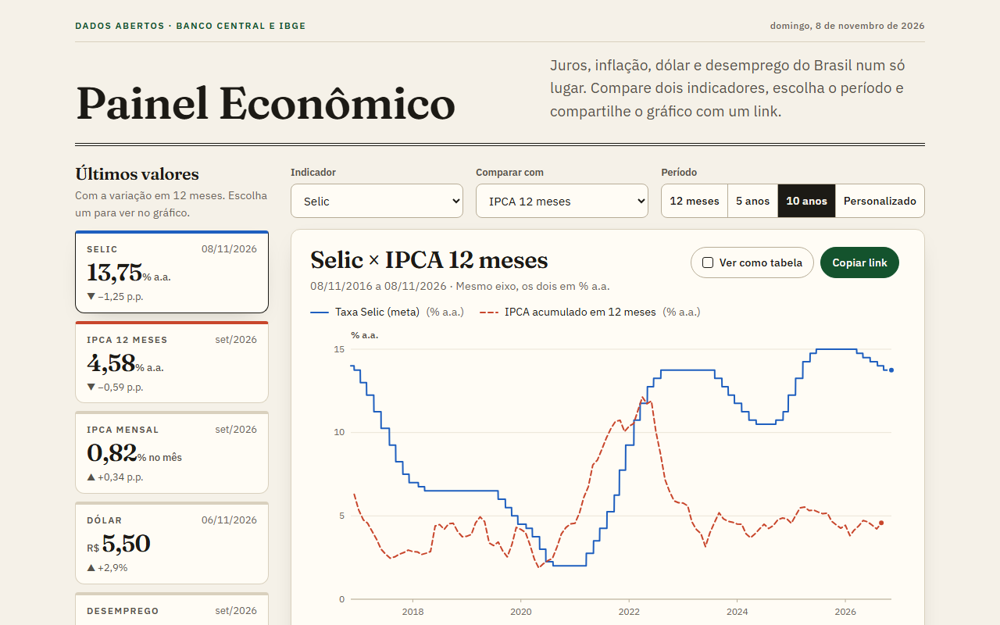
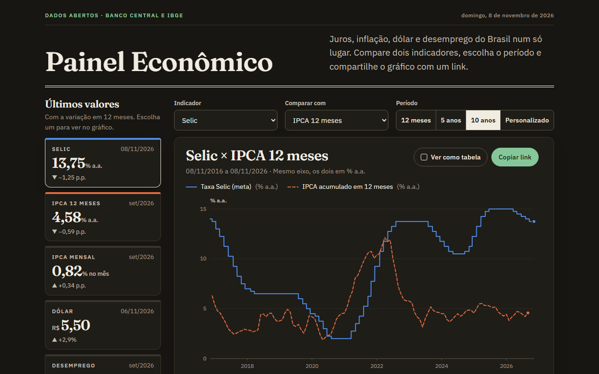
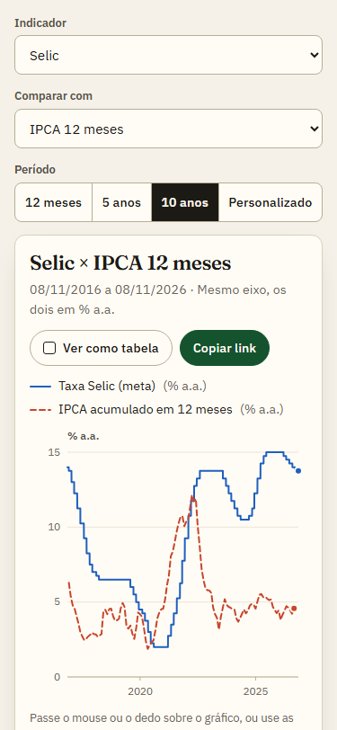
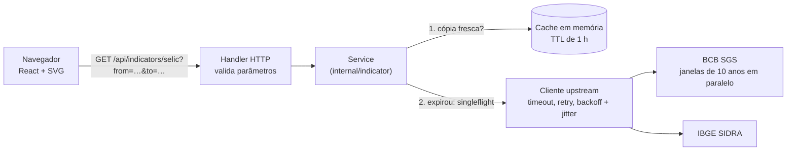

# Painel Econômico

Selic, inflação, dólar e desemprego do Brasil num só painel, com os dados abertos do Banco Central e do IBGE, uma API em Go que faz cache e normaliza as séries e gráficos que você compartilha com um link.



<details>
<summary>Tema escuro e celular</summary>





</details>

## O problema

Os dados existem e são públicos, mas cada API tem um formato, um limite e séries com códigos difíceis de achar. A taxa Selic é a série 432 do SGS, o dólar é a série 1, e o desemprego mora na tabela 6381 do SIDRA, com períodos em trimestres móveis. O SGS recusa consultas de mais de 10 anos em séries diárias, e as duas APIs às vezes ficam lentas ou fora do ar. Quem só quer ver como a inflação andou perto dos juros no último ano acaba desistindo.

O Painel Econômico esconde tudo isso atrás de uma API única, com cache, e de uma interface que responde à pergunta em um clique.

## Funcionalidades

- **Últimos valores** de cinco indicadores, com a variação em 12 meses (em pontos percentuais para taxas e em % para o dólar). Clicar num cartão leva o indicador para o gráfico.
- **Gráfico de linha** com períodos prontos (12 meses, 5 anos, 10 anos) ou intervalo personalizado desde 2000.
- **Comparação de dois indicadores.** Se têm a mesma unidade (Selic e IPCA 12 meses, ambos em % a.a.), dividem o mesmo eixo. Se não têm, cada um ganha seu painel, empilhados sobre o mesmo eixo de tempo.
- **Link compartilhável:** todo o estado fica na URL (`?indicador=selic&comparar=ipca-12m&periodo=10a`), e o botão **Copiar link** copia o endereço.
- **Ver como tabela:** os mesmos dados numa tabela acessível. Se uma série é diária e a outra mensal, a diária vira o último valor de cada mês para as linhas baterem.
- **Estados de carregamento, erro e dado desatualizado.** Ao trocar o período, o gráfico anterior fica esmaecido até o novo chegar. Se a fonte cair, a API devolve a última cópia boa e a tela avisa de quando ela é.
- **Acessível:** navegação por teclado no gráfico (setas, Home, End, PageUp e PageDown leem cada ponto), resumo em texto para leitores de tela, foco visível, contraste conferido nos dois temas e linhas diferenciadas também pelo traço, não só pela cor.
- **Tema claro e escuro** pelo `prefers-color-scheme` e layout que funciona a partir de 375 px de largura.

## Stack

| Camada | Tecnologia |
| --- | --- |
| API | Go 1.27, só biblioteca padrão (`net/http`, `log/slog`, `embed`) + `golang.org/x/sync` (singleflight e errgroup) |
| Front-end | React 19, TypeScript 6 (modo estrito), Vite 8, gráfico em SVG feito à mão |
| Testes | `go test` com `httptest` (testes de tabela), Vitest |
| Qualidade | gofmt, go vet, staticcheck, ESLint (typescript-eslint estrito, react-hooks, jsx-a11y), Prettier |
| CI | GitHub Actions (`.github/workflows/ci.yml`) |
| Deploy | Um binário com o front-end embutido; Dockerfile multi-stage para Render ou Fly.io |

## Arquitetura



O caminho de uma requisição:

1. O navegador pede `GET /api/indicators/{id}?from=AAAA-MM-DD&to=AAAA-MM-DD`. O handler valida as datas e responde `400` com JSON se algo estiver errado.
2. O service procura o indicador no cache. O cache guarda o **histórico inteiro** de cada indicador (desde 2000), então qualquer período sai da mesma entrada: o service só recorta as datas pedidas.
3. Se a cópia expirou, o service busca de novo na fonte. Pedidos simultâneos do mesmo indicador compartilham uma única busca (singleflight), e a busca não é cancelada se o primeiro cliente desistir.
4. O cliente upstream faz cada tentativa com timeout e repete erros 5xx, 429 e timeouts com backoff exponencial e jitter. Para o SGS, divide o período em janelas de até 10 anos e busca todas em paralelo.
5. Se a fonte falhar e houver uma cópia antiga, a resposta sai com essa cópia e `"stale": true`. Sem cópia nenhuma, a resposta é `502` com uma mensagem em JSON.

O mesmo binário serve o front-end compilado (`web/dist`, embutido com `embed`), então tudo roda numa origem só, sem CORS, e com uma Content-Security-Policy que só permite recursos do próprio site.

```
cmd/server/          main (configuração, injeção de dependências, shutdown) e o catálogo de indicadores
internal/api/        rotas, validação, respostas JSON, arquivos estáticos e middlewares (log, cabeçalhos de segurança)
internal/indicator/  tipos do domínio e o service (cache, singleflight, dado desatualizado)
internal/cache/      cache em memória com TTL
internal/upstream/   cliente HTTP com timeout, retry e backoff com jitter
internal/bcb/        SGS do Banco Central: janelas de 10 anos e parser
internal/ibge/       SIDRA do IBGE: consulta e parser dos períodos
internal/config/     variáveis de ambiente com valores padrão
web/                 front-end (React + Vite) e web/embed.go, que embute o build no binário
```

### API

| Rota | Resposta |
| --- | --- |
| `GET /api/indicators` | `{"indicators": [{"id", "name", "shortName", "unit", "frequency", "description", "source", "sourceUrl"}]}` |
| `GET /api/indicators/{id}?from=AAAA-MM-DD&to=AAAA-MM-DD` | `{"indicator": {…}, "points": [{"date": "2026-09-01", "value": 4.58}], "stale": false, "fetchedAt": "…"}`. Sem `to`, vale hoje; sem `from`, um ano antes de `to`. |
| `GET /healthz` | `{"status": "ok"}` |

Erros sempre saem em JSON: `{"error": "mensagem"}`, com `400` (parâmetro inválido), `404` (indicador ou rota inexistente) ou `502` (fonte fora do ar e nada em cache).

## Fontes de dados

| Indicador (`id`) | Série | Frequência | Observações |
| --- | --- | --- | --- |
| Selic meta (`selic`) | [SGS 432](https://dadosabertos.bcb.gov.br/dataset/432-taxa-de-juros---meta-selic-definida-pelo-copom), Banco Central | diária | Tem valor em todos os dias, inclusive fins de semana, e já traz datas futuras (a meta vale até a próxima reunião do Copom). Por isso a API só busca até hoje. |
| IPCA acumulado em 12 meses (`ipca-12m`) | SGS 13522 (IBGE, via Banco Central) | mensal | Usada a série oficial em vez de calcular a partir da 433 (ver decisões). |
| IPCA mensal (`ipca`) | SGS 433 (IBGE, via Banco Central) | mensal | Conferida com a [tabela 1737 do SIDRA](https://sidra.ibge.gov.br/tabela/1737): setembro de 2026 = 0,82% no mês e 4,58% em 12 meses nas duas fontes. |
| Dólar PTAX venda (`dolar`) | [SGS 1](https://dadosabertos.bcb.gov.br/dataset/1-taxa-de-cambio---livre---dolar-americano-venda---diario), Banco Central | dias úteis | Antes de julho de 1994 os valores estão em outras moedas; o painel começa em 2000. |
| Taxa de desocupação (`desemprego`) | [SIDRA tabela 6381](https://sidra.ibge.gov.br/tabela/6381), variável 4099, PNAD Contínua | mensal | Trimestre móvel. O código `202609` é o trimestre jul–ago–set de 2026 e vira a data `2026-09-01`. Começa em março de 2012. |

Consultas usadas:

- SGS: `https://api.bcb.gov.br/dados/serie/bcdata.sgs.{código}/dados?formato=json&dataInicial=dd/MM/aaaa&dataFinal=dd/MM/aaaa`
- SIDRA: `https://apisidra.ibge.gov.br/values/t/6381/n1/all/v/4099/p/{AAAAMM}-{AAAAMM}/f/c/h/n` (`n1/all` = Brasil, `f/c` = só códigos, `h/n` = sem linha de cabeçalho)

Limites e comportamentos que encontrei testando as APIs (novembro de 2026):

- **SGS, séries diárias:** no máximo 10 anos por consulta. Acima disso a resposta é `406` com a mensagem "O sistema aceita uma janela de consulta de, no máximo, 10 anos em séries de periodicidade diária". O intervalo de 31/12/2015 a 31/12/2025 passa e o de 30/12/2015 a 31/12/2025 não. As séries mensais aceitam qualquer intervalo.
- **SGS, intervalo sem dados:** responde `404` com `{"erro": {"detail": "… Value(s) not found"}}`. A API trata isso como lista vazia.
- **SGS, latência:** a resposta passa por um CDN (`cache-control: max-age=900`). Uma consulta que não está no CDN levou de 5 a 7 segundos; a mesma consulta repetida, menos de meio segundo.
- **SIDRA:** intervalo vazio devolve `[]`; parâmetro inválido devolve `400` com texto puro; valores ausentes vêm como símbolos (`-`, `..`, `...`, `X`) e são ignorados.

## Como rodar localmente

Pré-requisitos: Go 1.27 ou mais novo e Node.js 26 (versão testada). Nenhuma chave de API é necessária.

```bash
# 1. Compilar o front-end (o binário Go embute a pasta web/dist)
cd web
npm ci
npm run build
cd ..

# 2. Subir o servidor
go run ./cmd/server
# abra http://localhost:8103
```

Para gerar o binário único:

```bash
go build -o bin/painel-economico ./cmd/server   # no Windows: bin/painel-economico.exe
./bin/painel-economico
```

**Modo de desenvolvimento**, com recarga automática do front-end:

```bash
go run ./cmd/server        # terminal 1: API em http://localhost:8103
cd web && npm run dev      # terminal 2: http://localhost:5103, que repassa /api para a porta 8103
```

Configuração por variáveis de ambiente (todas opcionais):

| Variável | Padrão | Uso |
| --- | --- | --- |
| `PORT` | `8103` | Porta HTTP (Render e Fly definem a sua) |
| `CACHE_TTL` | `1h` | Por quanto tempo uma série é considerada fresca |
| `UPSTREAM_TIMEOUT` | `15s` | Timeout de cada tentativa nas APIs do BCB e do IBGE |
| `UPSTREAM_MAX_ATTEMPTS` | `3` | Tentativas por consulta, de 1 a 10 |
| `LOG_LEVEL` | `info` | `debug`, `info`, `warn` ou `error` (logs em JSON) |

## Testes e qualidade

```bash
# Go (rode antes o build do front-end, porque o pacote web embute web/dist)
gofmt -l cmd internal web/embed.go     # não deve listar nada
go vet ./...
go run honnef.co/go/tools/cmd/staticcheck@v0.8.2 ./...
go test ./...

# Front-end
cd web
npm run format:check
npm run lint
npm run typecheck
npm test
```

Os testes Go usam servidores falsos com `httptest` no lugar do BCB e do IBGE e cobrem o parser de cada fonte, a divisão em janelas de 10 anos, as tentativas com backoff (5xx, 429, timeout, contexto cancelado), o cache, o dado desatualizado, a deduplicação de buscas simultâneas, a validação de parâmetros e as rotas. No front-end, o Vitest cobre o estado na URL, as transformações de dados (tabela, variação em 12 meses, busca binária), a geometria do gráfico (eixo compartilhado ou painéis), as escalas e os formatos brasileiros.

O detector de corrida (`go test -race ./...`) precisa de cgo e de um compilador C. Ele roda no GitHub Actions (Linux), mas não rodou na máquina Windows onde o projeto foi feito, que não tem gcc.

Para refazer os prints de `docs/`, com o servidor rodando: `cd web && npx playwright install chromium && npm run screenshots`.

## Decisões técnicas

| Decisão | Alternativa | Por quê |
| --- | --- | --- |
| `net/http` da biblioteca padrão, com rotas por método e caminho | Gin, Echo ou Chi | São três rotas. Desde o Go 1.22 o `ServeMux` entende `GET /api/indicators/{id}`, então um framework só traria dependência. |
| Cache com o histórico inteiro de cada indicador, recortado a cada pedido | Uma entrada por indicador e período | São só cinco chaves. Qualquer período sai da mesma cópia e cada série vai à fonte no máximo uma vez por TTL. |
| Cache em memória atrás de uma interface; Redis fica para depois | Redis desde o início | Com uma instância só, Redis seria mais um serviço para pagar e manter sem ganho nenhum. Ele passa a valer quando houver várias instâncias ou quando o cache precisar sobreviver a reinícios (no plano grátis do Render a instância dorme). A interface `indicator.Cache` já permite a troca. |
| Devolver a última cópia boa com `stale: true` quando a fonte falha | Responder erro 502 | Indicadores mudam devagar: um dado de algumas horas atrás é muito mais útil que uma tela de erro. A interface avisa a data da cópia. |
| Repetir só 5xx, 429 e timeouts, com backoff exponencial e jitter | Repetir tudo, em intervalo fixo | Um 4xx não se resolve sozinho. O jitter evita que vários clientes repitam ao mesmo tempo e piorem a sobrecarga da fonte. |
| Janelas de 10 anos buscadas em paralelo (`errgroup`) | Uma consulta por pedido | O SGS recusa mais de 10 anos em séries diárias. Em paralelo, o histórico desde 2000 chega no tempo da janela mais lenta. |
| Série oficial SGS 13522 para o IPCA em 12 meses | Calcular a partir da série mensal 433 | O IBGE calcula o acumulado com números-índice. Multiplicar as variações mensais arredondadas dá 4,576% em setembro de 2026, contra 4,58% oficiais. |
| Gráfico em SVG feito à mão | uPlot, Recharts, Chart.js | São duas linhas. Feito à mão, tenho controle total da acessibilidade (o gráfico é um `slider` navegável por teclado, com o valor lido em voz alta), as cores vêm das variáveis CSS dos dois temas e não entra nenhuma dependência de gráfico. O uPlot desenha em canvas, sem elementos para leitor de tela. |
| Mesma unidade divide um eixo; unidades diferentes ganham painéis empilhados com o mesmo eixo de tempo | Dois eixos Y ou índice base 100 | Dois eixos Y no mesmo gráfico criam cruzamentos que não existem, porque cada escala é arbitrária. O índice base 100 não faz sentido para taxas, e quatro dos cinco indicadores são taxas ("a Selic subiu 30%" confunde com "subiu 3 p.p."). |
| IPCA 12 meses com a unidade "% a.a." | Unidade "% em 12 meses" | Um acumulado de 12 meses é uma taxa anual. Com a mesma unidade, o par mais pedido (Selic × inflação) cai no mesmo eixo e mostra o juro real. |
| Estado na query string, com nomes em português e `replaceState` | React Router ou `localStorage` | É uma página só. A URL vira o link compartilhável, e `replaceState` evita que o botão Voltar percorra cada filtro. |
| Front-end embutido no binário com `embed` | Servir o front-end num CDN separado | Um artefato só para publicar, mesma origem (sem CORS) e uma CSP restrita. |
| Fuso fixo UTC−3 | Carregar a base de fusos (`time/tzdata`) | O Brasil não tem horário de verão desde 2019, então o deslocamento fixo é exato e a imagem mínima não precisa da base de fusos. |

## Deploy no plano gratuito do Render

O `Dockerfile` tem três estágios: compila o front-end com Node, compila o Go com o front-end embutido (binário estático, sem cgo) e copia só o binário para uma imagem distroless sem shell, que roda como usuário sem privilégios.

> **Atenção:** o Docker não estava instalado na máquina onde o projeto foi feito, então o `Dockerfile` **não foi testado**. Os mesmos passos (build do front-end, depois `go build` com `CGO_ENABLED=0`) foram rodados fora do Docker.

Passo a passo (é preciso uma conta no Render; dá para entrar com o GitHub):

1. Crie um repositório no GitHub e envie o projeto (`git push`).
2. Entre em [render.com](https://render.com) com a conta do GitHub.
3. Clique em **New** › **Web Service** e escolha o repositório.
4. O Render detecta o `Dockerfile`. Confira **Language: Docker** e **Branch: main**.
5. Em **Instance Type**, escolha **Free**.
6. Em **Advanced**, preencha **Health Check Path** com `/healthz`. Não defina `PORT`: o Render define a sua e o servidor lê essa variável. `CACHE_TTL` e `LOG_LEVEL` são opcionais.
7. Clique em **Create Web Service** e espere o build. Depois abra `https://<seu-serviço>.onrender.com/healthz` e a página inicial.
8. A cada `git push` na `main`, o Render publica de novo sozinho.

Sobre o plano gratuito: o serviço dorme depois de um tempo sem acessos, e a primeira visita seguinte espera ele acordar (pode levar perto de um minuto). Como o cache é em memória, ele volta vazio, e a primeira consulta de cada série ainda vai ao BCB e ao IBGE. Antes de colocar o link no portfólio, vale abrir o site uma vez para acordá-lo.

**Fly.io** também serve: `fly launch` usa o mesmo `Dockerfile`. Configure `internal_port = 8080` e um health check HTTP em `/healthz`.

## Próximos passos

- **Redis** como segunda implementação de `indicator.Cache`, quando houver mais de uma instância ou para o cache sobreviver ao sono do plano gratuito.
- **Stale-while-revalidate:** responder na hora com a cópia expirada e atualizar em segundo plano, para ninguém esperar a fonte.
- Aquecer o cache ao iniciar o servidor.
- Mais indicadores: IGP-M (SGS 189), CDI (SGS 12) e o juro real (Selic menos IPCA 12 meses).
- Exportar a tabela em CSV.
- Testes de ponta a ponta com Playwright no CI (o script de prints já usa Playwright).
- Versão em inglês da interface.

## English summary

**Painel Econômico** is a dashboard of Brazilian economic indicators (Selic policy rate, IPCA inflation, USD/BRL PTAX rate and unemployment) built on the open data APIs of the Central Bank (SGS series 432, 433, 13522 and 1) and IBGE (SIDRA table 6381).

- **Back-end:** Go 1.27 with only the standard library plus `golang.org/x/sync`. It normalizes both upstream formats into `{date, value}` points and caches each indicator's full history in memory behind a small interface (Redis is a documented next step). The upstream client has per-attempt timeouts and retries 5xx, 429 and timeouts with exponential backoff and full jitter. It splits SGS queries into 10-year windows, the limit the API enforces on daily series, and fetches them concurrently. Concurrent requests share one fetch (singleflight), and when an upstream fails it serves the last good copy flagged `"stale": true`. The React build is embedded, so the app ships as a single binary.
- **Front-end:** React 19 and strict TypeScript, with a hand-rolled, keyboard-accessible SVG chart. Indicators with the same unit share one axis; different units get stacked panels over a shared time axis instead of a dual axis. The whole view lives in the URL, there is a "copy link" button and an accessible table view, and light and dark themes work down to 375 px.
- **Quality:** table-driven Go tests with `httptest` fake upstreams, Vitest for URL-state and data-transform helpers, gofmt/vet/staticcheck, ESLint (strict type-checked, jsx-a11y) and Prettier, all run by GitHub Actions. `go test -race` runs in CI only, because the Windows development machine has no C compiler.
- **Run it:** `cd web && npm ci && npm run build && cd .. && go run ./cmd/server`, then open http://localhost:8103. Deployment uses a multi-stage Dockerfile on Render's free tier (untested locally: Docker was not available).

---

Feito por **Gabriel Baldi** · [Portfólio](https://gabrielbaldi.github.io) · [LinkedIn](https://www.linkedin.com/in/gabriel-baldi-111959293/) · [GitHub](https://github.com/GabrielBaldi) · Licença [MIT](LICENSE)
